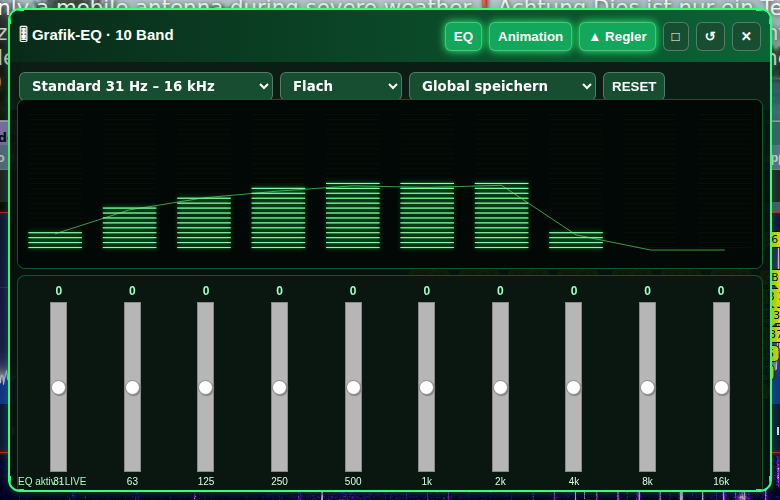

# DNX Grafik-EQ 10 Band

<!-- DNX-DISCLAIMER-START -->
> **Wichtiger Hinweis / Vollständige Distanzierung (Hobby-Mod-Mode)**
>
> - **Vollständige Distanzierung:** Ich distanziere mich in jeder Hinsicht vollständig vom Projekt **OpenWebRX / OpenWebRX+** sowie dessen Entwicklern und Betreibern. Es besteht keinerlei Verbindung, Zusammenarbeit, Prüfung, Befürwortung oder Partnerschaft.
> - **Keine öffentlichen/offiziellen OpenWebRX-Plugins (nur Mod-Mode):** Bei diesem Projekt handelt es sich ausdrücklich **nicht** um ein öffentliches oder offizielles Plugin von OpenWebRX, sondern ausschließlich um einen privaten, inoffiziellen **Mod-Mode** (Eigenmodifikation).
> - **Warum bewusst kein reines Browser-JavaScript (Mod-Mode-Architektur):** Viele Funktionen (z. B. serverseitige Speicherung, Konten-/Rollenverwaltung, Profil-Synchronisation, VNC-/websockify-Brücken, geschützte Schnittstellen, Docker-/Systemintegration und stabile UI-Anpassungen) lassen sich sauber und sicher nicht allein über simples Client-JavaScript umsetzen, ohne den OpenWebRX-Kern umzubauen oder Browsergrenzen zu umgehen. Deshalb setzt dieses Projekt bewusst auf getrennte Begleitmodule, Shell-Installer und Dienste im **Mod-Mode** statt alles künstlich in reines JavaScript zu pressen.
> - **Kein öffentlicher Support & keine Haftung:** Es gibt **keinen öffentlichen Support**, keine Garantie und keine Haftung. Nutzung, Installation und Anpassung erfolgen vollständig auf eigene Gefahr (immer vorher Backups anlegen und zunächst im eigenen Testsystem prüfen).
> - **Reines Hobbyprojekt – frei nutzbar, änderbar & verbreitbar:** Dieses Projekt entsteht ausschließlich aus reinem Hobby und Interesse am gemeinsamen Funk-/SDR-Hobby. Es steht ausdrücklich frei zur Verfügung und darf frei genutzt, weiterverbreitet, verändert und verbessert werden.
<!-- DNX-DISCLAIMER-END -->

<!-- DNX-PREVIEW-START -->
## Live-Vorschau


<!-- DNX-PREVIEW-END -->

Private, inoffizielle Hobby-Anpassung für eine vorhandene OpenWebRX+-Installation.

## Funktionen

- echter 10-Band-WebAudio-Equalizer
- Bypass/EQ AN-AUS
- abschaltbare animierte Pegelbalken und Spektrallinie
- Standardbänder 31 Hz bis 16 kHz
- Funk-/Sprachbänder 100 Hz bis 5 kHz
- Presets Flach, Sprache, Funk, Bass, Musik, Höhen und Rauscharm
- eigenes Preset durch Regleränderung
- kompakter auf-/zuklappbarer Bereich im Receiver-Panel
- großes verschiebbares, maximierbares und resizebares Fenster
- grüner Rahmen und sichtbare grüne Resize-Ecken
- globale oder profilspezifische Speicherung im Browser

## Installation

```bash
chmod +x install.sh
sudo ./install.sh install
```

## Update / Status / Entfernen

```bash
sudo ./install.sh update
./install.sh status
sudo ./install.sh uninstall
```

Backups liegen unter `/opt/dnx-graphic-eq-backups`.

## Technischer Hinweis

Das Modul schleift zehn `BiquadFilterNode`-Filter zwischen den vorhandenen OpenWebRX-GainNode und das AudioContext-Ziel. Ein `AnalyserNode` erzeugt die Animation. Bei Inkompatibilität sofort über den EQ-Schalter auf Bypass stellen oder das Modul deinstallieren.

## Haftung und Unabhängigkeit

Rein privates, unabhängiges Hobbyprojekt. Kein Projekt, Produkt oder offizielles Plugin von OpenWebRX oder OpenWebRX+. Keine Verbindung, Beauftragung, Unterstützung, Prüfung oder Empfehlung durch deren Entwickler oder Rechteinhaber.

Installation, Nutzung, Veränderung und Weitergabe vollständig auf eigene Gefahr. Soweit gesetzlich zulässig keine Haftung für Schäden, Ausfälle, Datenverlust, Hörschäden oder sonstige technische und rechtliche Folgen. Lautstärke vorsichtig einstellen, vorher Backups erstellen und zuerst auf einem Testsystem prüfen.
